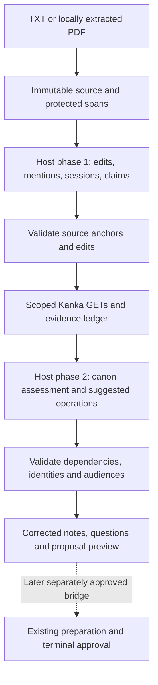

# Canon-aware session notes: implementation design

Status: architecture on `feat/canon-aware-session-notes`, after PR #5.
The TXT core, optional local PDF adapter and GET-only preview workflow are
implemented locally. The opt-in supervised preparation/result bridge is also
implemented with offline acceptance; OCR execution and live bridge acceptance remain pending.
See [usage and current limits](using-session-notes.md).
This document grants no permission to write to Kanka.
The behavioral contract is [canon-aware-instructions.md](../canon-aware-instructions.md).
This document specifies how to implement that contract using the current code.

## 1. Delivery boundary

The first complete release accepts TXT notes, preserves dialogue, validates
host-generated corrections, resolves entities with GET requests and produces
source-backed local proposals. It survives restarts and repeat imports. The next
slice adds local PDF extraction with page provenance and explicit OCR handoff
requests, using optional pypdf. A separately configured bridge now prepares selected
operations for existing terminal approval and execution, and records GET-verified
outcomes. No new dependencies are required for TXT or handoff use.

The host model supplies semantic judgments: scene boundaries, grammar edits,
speaker/alias interpretation, claims and suggested organization. Python verifies
their evidence, resolves identities, computes diffs and renders the preview.
There is no model call inside the MCP server. Merely importing a document does
not make its contents canon or enqueue existing mutation executors.



The host processes bounded sections within each phase. It receives a shared
mention/evidence ledger rather than the complete campaign on every turn.
If an ambiguity blocks one operation, retain that blocker and render the rest.

## 2. Code changes and ownership

Add these modules incrementally; do not create empty framework layers:

| Path | Responsibility |
| --- | --- |
| `src/loremaster/note_models.py` | Strict input/output records, finite operation variants and references |
| `src/loremaster/note_text.py` | TXT decoding, source blocks, anchors, dialogue guards, edits and escaped rendering |
| `src/loremaster/note_pdf.py` | Optional bounded local extraction worker, page/position provenance, uncertainty and OCR handoff requests |
| `src/loremaster/note_store.py` | Explicit private import storage, immutable revisions and optimistic version checks |
| `src/loremaster/session_notes.py` | Coordinate validation, deduplicated GETs, evidence and proposal preparation |
| `src/loremaster/note_bridge.py` | Explicit single-operation supervised preparation, source-bound review and verified dependency/result linkage |
| `src/loremaster/notes_cli.py` | Import user-selected local files without passing an arbitrary filesystem path to an MCP tool |
| `src/loremaster/server.py` | Register four optional note tools and close their store during lifespan shutdown |

Begin with plain functions and one `SessionNoteService`, not a generic workflow
engine. Split proposal rendering into another module only if it becomes hard to
read. The PDF adapter sits beside `note_text.py`, behind a narrow extraction
function returning the same source blocks with page metadata and warnings.

Reuse `KankaClient`, existing search/aggregate semantics, Pydantic validation and
finite creation/edit models. Do not instantiate `CreationService`, `EditService`
or `LocalApprovals` from the note service. Do not change their tables, fingerprints
or approvals to store extraction work. Semantic preview generation is independent
of permission to execute an operation.

## 3. Typed records

Use strict, extra-forbidden Pydantic models. Raw source and dialogue strings must
not use whitespace-stripping validators. Use immutable tuples internally and
defensive serialized copies at boundaries. Validate IDs, lengths and finite
enums explicitly; no runtime security check relies on Python `assert`.

| Record | Minimum fields and invariant |
| --- | --- |
| `ImportContext` | Campaign, source language, declared audience, optional locale/note-taker; audience is a content label, not authentication |
| `SourceRevision` | Document/import IDs, revision, original/extracted hashes, source method, encoding, extraction warnings and coverage |
| `SourceBlock` | Block ID, exact text, source order, line range and optional page/region; joins preserve the extracted source |
| `TextAnchor` | Block ID, exact excerpt, optional exact preceding/following context; resolve to exactly one source span |
| `ProtectedSpan` / `TextEdit` | Resolved span and evidence; an edit carries exact before/after text and cannot intersect protected text |
| `Session` | Server-assigned stable key, source spans, label, real date and fantasy date separately, date evidence/uncertainty |
| `Mention` / `AliasBinding` | Local key, source anchor, possible type, scope and candidate references; preserve alternatives |
| `Claim` | Local key, anchors, subject/object references, predicate, polarity, attribution, event time and epistemic qualifiers |
| `CanonEvidence` | Server-issued key, verified campaign/entity/record IDs, source endpoint, excerpt, retrieval/version metadata and completeness |
| `Assessment` | Claim key, proposed canon state, explanation and exact evidence references; semantic judgment remains reviewable |
| `PlannedOperation` | Stable logical key, finite action, typed target/body, source/claim references, audience, dependencies and computed blockers |
| `NotePreview` | Corrected edition, operation groups, questions, coverage, processing metrics and all relevant revision digests |

Local keys such as `mention-3` and `new-quest-1` identify proposed records only.
A reference is a discriminated union of a verified entity reference and a local
proposal reference. Never encode a future entity as `0`, a negative ID or a
placeholder hidden inside HTML. Attachment references include owner and exact
post/inventory/relation IDs; an item/entity ID is not an attachment ID.

Assessments distinguish their model-proposed semantic state from server-computed
validation results. A valid citation proves that the cited text exists, not that
its contents are true. `confirmed_canon` needs an identified authoritative claim
or explicitly recorded GM decision; an unsupported label becomes unresolved.

## 4. Private storage and source entry

Enable the feature only with `KANKA_NOTES_DATABASE`, an absolute private SQLite
file outside the public checkout. This is an explicit local store using Python's
existing SQLite dependency; no database service or automatic startup store.
Keep it separate from `KANKA_CREATION_DATABASE`, including resolved-path checks.
Reuse the private-file policy without opening an approval database as a shortcut.

Use three small tables: documents for lineage/context, imports for immutable
source/extraction revisions, and snapshots for versioned analysis/evidence/preview
JSON. Store original bytes as a bounded private BLOB. Do not normalize every
claim into its own table. Updates append a snapshot and atomically advance its
head with an expected-version check. A stale update changes no existing state.

CLI imports and MCP imports use the same ingestion functions. The CLI accepts
an explicit local TXT/PDF path, strict TXT encoding or a PDF page range, and campaign ID; it reads the bytes
and returns an opaque import ID. It performs no Kanka writes and needs no API
token for extraction. Every later server access rechecks campaign scope.

PDF extraction runs in a fixed subprocess with a wall timeout and available POSIX
memory/CPU limits, without forwarding Kanka environment variables. Original PDFs
and extraction variants remain separate: changing the range or extractor metadata
creates another immutable import in the same explicit document lineage. Existing
TXT stores migrate without replacing their sources or snapshots. Page ranges do
not merge automatically; omitted ranges remain visible. Position hints and quote
fidelity refer only to extracted text. All PDFs require visual review; unreadable
pages cannot be claimed as analysed and uncertain pages block dependent previews.
See the usage guide for concrete bounds and page states. OCR requests carry source
hash/page/reason but execute no provider, local engine or upload.

Small pasted notes may enter through the MCP text tool. Their source method is
`inline_utf8`: the received UTF-8 representation is preserved, with no claim that
it equals the original bytes of a file elsewhere. Large files enter via the CLI
so the model need not resend the whole document as a tool argument.

No MCP tool accepts a filesystem path, arbitrary URL or deletion command. Export
files are a trusted-host/CLI operation. Inspection is paginated and omits absolute
paths, credentials and unrelated imports. Retain prior snapshots for repeat-import
comparison; cleanup/retention is an explicit host operation, not inferred here.

## 5. MCP contract

Add `notes: SessionNoteService | None = None` to `create_server`. With no note
configuration, existing tool sets remain unchanged. Enabling notes adds four
tools: 12 total on a read-only server, 25 with creation-only or edit-only services,
and 38 with both existing write services. Registration never grants write scope.

Every note tool takes `campaign_id` and verifies that the import belongs to that
campaign. Import IDs are opaque references, not permission tokens.

| Tool | Input | Result and effect |
| --- | --- | --- |
| `import_session_notes` | Context, exact inline text, filename label; optional explicit lineage/revision reference | Validate/store a source revision; return import ID, version, warnings and paginated block metadata |
| `inspect_session_notes` | Import ID, view, opaque cursor | Read source sections, analysis, evidence, preview, questions or coverage; no external writes |
| `submit_session_note_analysis` | Import ID, expected version, bounded section analyses or an issued continuation | Validate phase-one results, deduplicate/resolve mentions through GETs and store an evidence snapshot |
| `prepare_session_note_proposals` | Import ID, expected version, evidence digest, bounded assessments and operation candidates | Validate phase two, group operations, render corrected notes and persist a local preview |

`inspect_session_notes` is read-only. The other three mutate local state, so their
annotations must say `readOnlyHint: false`, even though they cannot write to Kanka.
Identical content/version retries return the recorded result; changed content
with a stale expected version returns `note_revision_conflict`. No model-callable
approval, canon-confirmation privilege or execution tool is added.

Keep two short versioned host instruction templates in `session_notes.py` and
return the appropriate template with source/evidence inspection. Tool input
schemas define the structured response. Separate trusted instructions from source
content in the result. An installed wheel must work without reading Markdown
from this repository; do not require MCP sampling support or a backend model key.

Opaque page cursors bind the import, snapshot, view and position. Work
continuations additionally identify pending GET work and its analysis digest.
A continuation is a distinct resumable submission, not a replay of a completed
partial result. Exact retries return that submission's recorded response. Reject
cursors from another campaign/import or an incompatible snapshot.

Return `CallToolResult` with structured data, campaign/import scope, completeness,
warnings, cursor and sanitized errors. Define a note-specific result schema;
do not invent a Kanka source URL to fit the existing HTTP read wrapper. Preserve
its error conventions where applicable and the existing 256 KiB response cap.
Paginate before that cap; an oversized unpageable record produces a size error.

Initial configurable safety defaults: 8 MiB original input, 128 KiB inline text,
128 KiB per structured submission, 16 KiB source sections and 128 KiB output
pages. Count UTF-8 bytes, not characters. These are local processing bounds,
not account-tier limits. Split long plain prose at a safe boundary; expose a
long protected dialogue block as a special paginated/unchanged source unit.
Never truncate source, model output or evidence silently to fit a tool response.

## 6. Phase one: faithful editing and extraction

Ingest TXT with explicit encoding or strict UTF-8/BOM handling. Preserve line
endings and a source reconstruction invariant. Build line/paragraph blocks and
provisional session-heading candidates; unfamiliar headings stay available for
the host to segment using anchored evidence.

Detect unambiguous quotation pairs and speaker lines before editing. Source
inspection exposes those spans as protected references, with read-only original
text available for attribution. The host may identify additional dialogue but
cannot remove protection through an ordinary analysis submission. Uncertain
boundaries protect the whole affected block pending a trusted-host decision.

The model submits small anchored edits rather than rewriting whole paragraphs:

```json
{
  "block_id": "b-12",
  "before": "L llego al Puente Gris.",
  "after": "L llegó al Puente Gris.",
  "reason": "Accent correction"
}
```

Python locates `before` in the exact block, using supplied surrounding context
when necessary. Zero matches or multiple matches fail that edit. Apply validated
nonoverlapping edits from right to left, reconstruct protected spans from the
source and preserve every untouched slice. Validate quote order/attribution and
coverage before generating escaped HTML. Interpretation that changes negation,
numbers or uncertainty remains visibly reviewable even if its anchors are valid.

Phase-one submissions also include sessions, mentions, aliases, claims and goals.
They carry exact source anchors; a model may suggest a date but cannot assign an
unambiguous server date without valid evidence/locale. All source sections must
be marked analysed, unchanged, pending or explicitly excluded. Partial work
renders as partial; it does not erase the remaining sections.

## 7. Entity resolution and canon evidence

Deduplicate lookup requests by campaign and scoped full-name candidate. Resolve
source glossaries before searching initials. Use existing NFC/case-folded exact
matching and verify selected records with `get_entity`; preserve accent identity.
Partial, fuzzy and acronym matches remain alternatives. Ambiguous exact names
remain blocked without a supported distinguishing reference or reviewer choice.

Search outcomes are `resolved`, `ambiguous`, `no_visible_match`, `inaccessible`
or `lookup_incomplete`. Only a completed visible search can produce the third
state, and that still does not prove global nonexistence. Store candidate/search
evidence independently of any proposed entity creation.

In the evidence view, a source-backed named mention of a supported creation type
with `no_visible_match` additionally yields `entity_creation_suggestion`, including
its source anchor, private default and approval requirement. It is an advisory
record, not a draft or execution grant. Partial matches, unverified acronym
expansions, unknown/unsupported types and incomplete or inaccessible searches do
not yield this suggestion. An earlier uncertain write remains a separate
execution blocker even when the current search suggests creation.

Retrieve relevant current descriptions and selected posts first. Read inventory
or relations only for claims needing them; use explicit aggregator sections and
honor every continuation/missing-data result. A broad text hit cannot establish
inventory ownership, an outgoing edge or an authoritative canon statement.

Each evidence reference identifies an actual stored GET result and exact excerpt.
The server derives its URL/IDs and validates any model-supplied excerpt by slicing
that record. The model cannot submit arbitrary endpoint URLs or certify an
unperformed lookup as complete. Repeated source text remains attributed even
when the model considers it likely true.

Use a process-local cache within the import run, partitioned by current credential
context, campaign and source audience. Refresh relevant evidence after restart,
credential changes or an explicit refresh; invalidate dependent assessments when
its content/identity/completeness changes. No cache becomes a persistent name-ID
dictionary. Persisted private evidence remains an audit snapshot, not proof of
current permissions or current canon.

Reuse existing per-operation request pacing and backoff. Bound logical read
operations and elapsed time per import and expose remaining work. If recording
actual HTTP attempts, count retries/pagination at the client request boundary,
not by estimating them from tool calls. The host owns the model-token budget;
server byte limits are enforceable, host-reported token counts are attributed
metrics rather than a claim of independently measured model usage.

Never hold a SQLite write transaction across network awaits. Validate the input
version, fetch a bounded group of reads, then commit evidence/pending work only
if that version still matches. Preserve completed work at those boundaries;
return a continuation for remaining reads when a budget/deadline is reached.
After cancellation, rerun an uncommitted GET group safely; there is no Kanka
mutation to reconcile. Reject structurally invalid submissions without changing
state, while valid but unresolved evidence remains visible as blocked work.

## 8. Phase two: assessments and Kanka planning

The host receives the corrected source sections, claims, resolved mentions and
relevant evidence, then submits assessments and operation candidates. Python
verifies references, supported fields, campaign/type/ownership, temporal/date
evidence, audience compatibility and dependency structure. It does not pretend
to infer all semantic contradictions from strings or implement grammar rules.

Use four finite action variants: create a supported core entity, create a post,
edit supported core fields, or edit an exact supported attachment. Reuse existing
draft/change schemas when all referenced IDs are resolved. Keep proposed-entity
references separate until prerequisites exist. Unsupported actions are retained
as `deferred`, never converted into arbitrary API calls.

Compute operation disposition: `ready_for_review`, `blocked`, `deferred` or
`already_represented`. These describe planning only, never approval. Recheck names
for proposed journal/quest/entity creation; reuse verified existing owners.
Descriptions need sourced content; a name alone cannot justify invented biography.

Group posts deterministically by owner reference, stable session key and audience,
then source order. Merge duplicate source claims. Keep distinct substantive scenes
separate only when the requested organization or size bound warrants it, using
stable part keys. Corrected full accounts belong in session journals; quest and
entity posts contain focused excerpts/summaries with provenance.

Default journal organization is one journal per session. An explicit context
option may instead select a verified existing journal receiving session posts.
Keep real dates in journal `date`, narrative fantasy dates in body/metadata and
post dates in titles/bodies. Do not derive chronology from API creation timestamps.

Quest objectives and child-goal relationships require source-backed assessments.
New child quests/notes depend on same-type parents. Existing reparenting and quest
elements/status writes remain deferred. The same rule applies to unsupported
race creation, location editing, standalone inventory additions/transfers and
new relations on existing owners; do not widen existing executors for this slice.

First-release candidates retain private-core/admin-and-creator-post defaults.
Role defaults separately to non-admin: private-core candidates carry a blocker
unless the host explicitly declares the selected campaign as admin after user
confirmation. Visibility 3 includes the creator; only category 2 is admin-only.
Executors recheck the policy and never widen a proposal's audience automatically.
The [non-admin publication workflow](non-admin-publication.md) now supports
explicit public candidates, original/candidate review and a distinct terminal
release acknowledgment. Private sources require an explicit body; full-session
publication is available only for explicitly public sources and still needs review.
Public quotes cannot silently expand private context. Private/unclassified canon
references or citations remain blockers, and public source visibility/content is
rechecked before send. Audience labels do not turn the current server into a player
permission layer. Every displayed quotation/citation/link must obey the audience
intersection of its supporting sources.

## 9. Review, versioning and repeat ingestion

The preview has four views: corrected notes with original/diff access, entity and
alias decisions, grouped Kanka operations with dependencies, and grouped questions.
Each operation shows its evidence, canon state, proposed audience, current target,
minimal field diff and reasons it cannot proceed. Output only justified questions;
unresolved dialogue speakers need not block unrelated grammar corrections.

An analysis edit invalidates dependent assessments/previews. A changed canon
snapshot invalidates affected operations. Keep the source revision unchanged and
append another analysis snapshot. Identical submissions are idempotent; stale
submissions must be rebased explicitly rather than silently merged.

Document lineage is explicit. Assign session keys at first accepted segmentation;
carry them across revisions by explicit session identifiers/evidence. A date or
title correction does not create another session. Ambiguous matches require a
selection; same-date sessions are distinct. Detect possible overlap across other
imports for review without silently merging their lineages.

Operation keys bind the logical document/session, destination, role, audience
and optional stable part identity. Content hashes track revisions separately.
During this read-only milestone, repeat ingestion compares previews and available
Kanka records and reports possible duplicates; it cannot promise execution-level
deduplication for writes made externally without a reliable recorded mapping.

The opt-in bridge stores preparation IDs and GET-verified universal/attachment IDs
against these keys. It prepares prerequisites first, binds verified returned IDs
into dependent drafts, and leaves approval/execution to existing tools. Each
concrete dependent payload requires its own terminal approval.
Existing executors own intent, uncertainty, reconciliation and read-back. The note
store cannot declare a Kanka write complete or erase an executor's uncertainty.

`KANKA_NOTES_HANDOFF=prepare` adds two tools only with notes and separately
configured supervisors. A handoff binds the reviewed preview digest/version,
revalidates existing canon and edit baselines, then records a durable intent before
calling typed preparation. Deterministic preparation IDs recover across the two
databases; existing IDs cannot change content or reset approval state. Provenance
is included in the authority store's exact approval digest. A separate inspection
can verify a completed executor result through GETs, never caller-supplied IDs.
Changed logical operations remain blocked rather than automatically rewriting an
existing mapping. Historical preparations survive note edits without automatic
revocation; review their recorded source and revoke obsolete ones explicitly.
See the usage guide for workflow, limits and incomplete/reconciliation behavior.

## 10. Delivery slices and verification

| Slice | Deliverable | Required exit evidence |
| --- | --- | --- |
| A: TXT core | Models, private store, CLI ingestion, anchors/quotes/edit rendering | Exact source reconstruction; preserved quotes; rejected ambiguous anchors; restart/version tests |
| B: GET-only proposals | Service, four MCP tools, entity/evidence resolution, previews/reimport | Full synthetic session workflow through real stdio and mocked HTTP; explicit partial/blocked results |
| C: PDF (local extraction implemented) | Optional local adapter, page/region warnings, unexecuted OCR handoff requests | Synthetic digital, image-only, mixed/column and damaged fixtures; surfaced uncertainty and no silent page loss; OCR accuracy untested |
| D: supervised bridge | Opt-in typed preparation mapping, source-bound terminal review and verified result linkage | Real stdio, synthetic HTTP, separate terminal approval and stale-state/recovery tests; scoped live creation and dependent-post acceptance documented in the publication guide |
| E: non-admin publication | Explicit public copies, source/privacy manifests, terminal publication digest and pre-send canon checks | Offline creation/edit/dependency and confidentiality regressions; scoped non-admin live creation of a character, dated journal and two dependent public posts from reviewed private synthetic notes; publication editing remains offline-tested |

Slices A and B constitute the first functional release; A alone is infrastructure.
Pypdf plain/layout and local `pdftotext` preserved the expected phrases in the
invented digital and column fixtures. Plain extraction supplies position visitors
without requiring a system binary, so the adapter uses optional pypdf. This does
not establish general PDF fidelity; see its [documented extraction limits](https://pypdf.readthedocs.io/en/stable/user/extract-text.html).
OCR remains a separately configured fallback, not a required external service for
every import. Slice C currently emits requests only; no OCR engine is integrated.

Tests should cover the synthetic example in the instructions, plus conflicting
initials, duplicate/accented names, unchanged dialogue typos, negated actions,
rumors, flashbacks, ambiguous/fantasy dates, same-date sessions, stale evidence,
pagination limits, reimport changes, privacy and embedded tool-use instructions.
Preview-only mocked HTTP must reject every non-GET request. Bridge acceptance
uses injected synthetic writers with separate local approvals. Assert existing tool registration
and writer behavior remain compatible, not just the new tool count.

Use focused tests during each slice, then run the repository's required install,
Ruff format/check/format-check and full Pytest sequence before publication.
Track quote/source invariants, reviewer corrections, unresolved decisions,
duplicate candidates, processing bytes, GET work and host-reported model usage.
Do not claim PDF fidelity, semantic correctness or live Kanka behavior solely
from mocked schemas or a well-formed model response.
